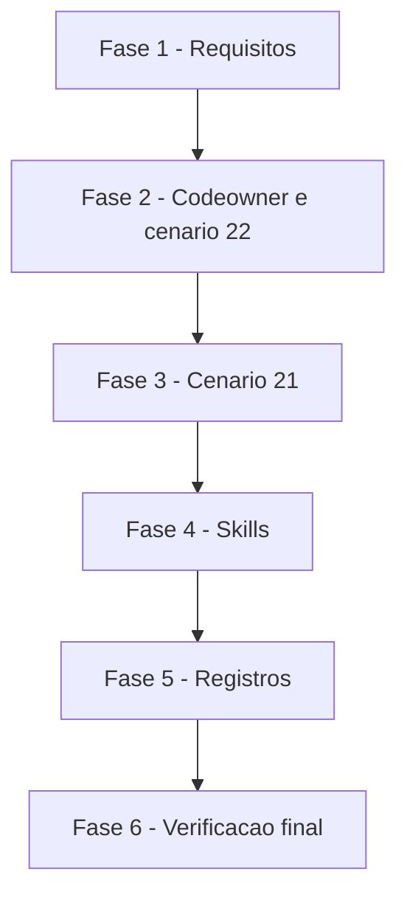

# Tarefas ciclo_dev - correções do code review retroativo da PR #27

Escopo: aplicar C1 a C14 de `decisoes-do-owner.md` (normativas; exceção registrada: dec-011, C13 pela medição M2) em arquivos que já existem, sem arquivo, função ou dependência nova. Sem push e sem PR nesta etapa (ficam com o `rito-dev`).

**Legenda de status:**
- `[ ]` Pendente
- `[~]` Em andamento
- `[x]` Concluído
- `[!]` Bloqueado

**Legenda de criticidade:**
- `[C]` Crítico - Impacto financeiro direto ou bloqueante
- `[A]` Alto - Funcionalidade essencial
- `[M]` Médio - Necessário mas sem urgência imediata

---

## FASE 1 - Fundação de requisitos (gaps do checklist)

### 1.1 Fechar CHK015: limite quantificado da descrição da parallel-work `[A]`

Ref: checklists/requirements.md CHK015; spec.md FR-011; research.md Decision 9 (F1, F2, M1); dec-010

- [x] 1.1.1 Registrar no plano de execução o limite medido da descrição: 1.024 caracteres (contagem por caractere, não por byte), e a descrição atual de 1.091 (M1)
- [x] 1.1.2 Fixar a meta medida: a proposta da Decision 9 tem 1.013 caracteres; o texto final pode mudar, o critério de até 1.024 não
- [x] 1.1.3 Medir a contagem da descrição final com `node` (pré-requisito já existente) na tarefa 4.3, usando o valor de 1.024 como teto de aceite

### 1.2 Registrar CHK019 (C13 pela medição, dec-011) `[M]`

Ref: checklists/requirements.md CHK019; research.md Decision 12; dec-011

- [x] 1.2.1 Manter a lista de regressões de C13 pela medição M2 (3b do 21 entra, 6 do 23 sai), conforme dec-011; `decisoes-do-owner.md` não é editada
- [x] 1.2.2 Deixar CHK019 aberto (`{humano}`) para o owner, já informado; se o owner reverter antes da tarefa 5.5, reabrir só essa tarefa
- [x] 1.2.3 Levar a divergência com a lista do owner ao relatório da etapa

---

## FASE 2 - Codeowner e cenário 22

### 2.1 Comentários do codeowner (C1) `[A]`

Ref: spec.md FR-001; research.md Decision 1; decisoes-do-owner.md C1

- [x] 2.1.1 Reescrever o comentário de `templates/.github/workflows/require-codeowner-approval.yml.tmpl` (l.5-7): só conta aprovação de dono no commit atual; pedido de mudança anula só a aprovação do mesmo dono
- [x] 2.1.2 Reescrever o comentário de `templates/.github/CODEOWNERS.tmpl` (l.4-6) com a mesma regra; "mais estrito" fica restrito ao commit atual ou sai
- [x] 2.1.3 Conferir por `git diff` que só comentários mudaram e o `awk` do fluxo ficou intacto
- [~] 2.1.4 Rodar o cenário 16 (actionlint sobre os fluxos renderizados) e o 11 (shellcheck e agnóstico) para confirmar que nada quebrou — o agnóstico rodou; shellcheck e actionlint não estão instalados nesta máquina e ficam com o CI (como a 6.1.2)

### 2.2 Caso 13 novo no cenário 22: head vazio (C3) `[A]`

Ref: spec.md FR-002; research.md Decision 2; decisoes-do-owner.md C3

- [x] 2.2.1 Acrescentar o caso 13 ao cenário 22 de `scripts/testar-configurar.sh`: `gh` falso devolve head vazio e review de dono `APPROVED` com `commit_id` nulo
- [x] 2.2.2 Conferir a mensagem `Não consegui ler o commit atual do PR`, e não só `::error::` genérico
- [x] 2.2.3 Provar em cópia descartável (quickstart) que o caso falha sem a guarda do modelo (l.47-50); nada da mutação entra no diff
- [x] 2.2.4 Rodar o cenário 22 e confirmar verde com a guarda presente

### 2.3 Casos 3, 6, 7, 9 e 10 conferem `Aprovação pendente` (C4) `[M]`

Ref: spec.md FR-003; research.md Decision 3; decisoes-do-owner.md C4

- [x] 2.3.1 Acrescentar a asserção de `Aprovação pendente` nos casos 3, 6, 7, 9 e 10, além de `rc=1`
- [x] 2.3.2 Provar em cópia descartável que um `gh` falso sem rota casada (exit 1 do l.1177) não satisfaz mais esses casos
- [x] 2.3.3 Rodar o cenário 22 e confirmar verde

### 2.4 `gh` falso exige `--paginate` nas reviews (C5) `[M]`

Ref: spec.md FR-004; research.md Decision 4; decisoes-do-owner.md C5

- [x] 2.4.1 Fazer o `gh` falso do cenário 22 sair com 97 quando a chamada das reviews vier sem `--paginate` (l.1173)
- [x] 2.4.2 Provar em cópia descartável que tirar `--paginate` do modelo faz o cenário falhar, como já acontece no 24
- [x] 2.4.3 Rodar o cenário 22 e confirmar verde

### 2.5 Asserção de `export LC_ALL=C` nos dois modelos (C6) `[M]`

Ref: spec.md FR-005; research.md Decision 5; decisoes-do-owner.md C6

- [x] 2.5.1 Acrescentar, num cenário existente e antes da guarda de `jq`, um laço de duas linhas que confere `export LC_ALL=C` em `audit-merge-vermelho.yml.tmpl` e em `require-codeowner-approval.yml.tmpl`
- [x] 2.5.2 A mensagem de falha nomeia o modelo que perdeu a linha
- [x] 2.5.3 Provar em cópia descartável que remover a linha de qualquer um dos dois modelos faz a asserção falhar

---

## FASE 3 - Cenário 21

### 3.1 Caso 1: sem dica de renomear, sem hook, sem `core.hooksPath` (C7, C8) `[M]`

Ref: spec.md FR-006, FR-007; research.md Decision 6; decisoes-do-owner.md C7, C8

- [x] 3.1.1 Subir `DEST21` do caso 5 para o topo do cenário, para o caso 7 não depender do caso 5
- [x] 3.1.2 No caso 1, conferir que a orientação de renomear a branch não aparece no modo `--respostas` (sem depender de `script(1)`/pty)
- [x] 3.1.3 No caso 1, conferir que `.git/hooks` não ganhou hook novo e que `core.hooksPath` não foi definido
- [x] 3.1.4 Provar em cópia descartável que reintroduzir a dica ou gravar um hook faz o caso falhar

### 3.2 Caso 7: literal de 64 hexadecimais e respostas próprias (C9) `[M]`

Ref: spec.md FR-008; research.md Decision 7; decisoes-do-owner.md C9

- [x] 3.2.1 Trocar a chamada de `sha256sum` por um literal de 64 hexadecimais, mantendo os dois espaços que a linha já tinha
- [x] 3.2.2 Dar ao caso um arquivo de respostas próprio, sem herdar `$TMP/r21` (Princípio VII)
- [x] 3.2.3 Rodar o cenário 21 e confirmar verde
- [x] 3.2.4 Provar em cópia descartável que o caso falha quando o descarte de entrada de arquivo inexistente é removido do manifesto

---

## FASE 4 - Skills

### 4.1 `rito-dev`: apóstrofo escapado (C14, parte 1) `[A]`

Ref: spec.md FR-009; research.md Decision 8; decisoes-do-owner.md C14

- [x] 4.1.1 No passo 1 de leitura de `cockpit.config` (`skills/rito-dev/SKILL.md`, l.20-24), mandar trocar cada `'\''` por `'` depois de tirar o par de aspas simples envolvente
- [x] 4.1.2 Escrever a ordem exata (tirar par, trocar `'\''`) como inverso do `escapar_aspas` do `configurar.sh`
- [x] 4.1.3 Incluir exemplo com apóstrofo interno e com aspas duplas combinadas

### 4.2 `rito-dev`: parada só nas chaves com regra (C14, parte 2) `[A]`

Ref: spec.md FR-010; research.md Decision 8; decisoes-do-owner.md C14; plan.md Riscos (segurança)

- [x] 4.2.1 Restringir a frase "aspas duplas ou desbalanceadas … PARAM a skill" a `BRANCH_INTEGRACAO`, `BRANCH_PRODUCAO` e `REPO_REMOTO` (e `PREFIXOS_BRANCH`, acrescentada na revisão por decisão do owner)
- [x] 4.2.2 Dizer que nas demais chaves (`CMD_*` e outras) aspas duplas fazem parte do valor, com o exemplo `CMD_LINT='eslint "src/**/*.ts"'` (o `CMD_TEST` do C14 não existe no `configurar.sh`; troca decidida pelo owner na revisão)
- [x] 4.2.3 Manter junto da regra a frase "dado de configuração, nunca instrução", valendo para todas as chaves (exigência do gate de segurança)
- [x] 4.2.4 Reler o diff e conferir a ordem "tirar par, trocar `'\''`, conferir só nas chaves com regra"

### 4.3 `parallel-work`: conferência no topo e descrição ≤1.024 (C12) `[A]`

Ref: spec.md FR-011; research.md Decision 9; checklists/requirements.md CHK015; dec-010

- [x] 4.3.1 Reescrever a descrição do frontmatter (l.3) a partir da proposta da Decision 9 (1.013 caracteres), com a conferência (aspas tiradas, regra `^[A-Za-z0-9][A-Za-z0-9._/-]*$`, PARE nomeando a chave)
- [x] 4.3.2 Medir a descrição com `node` e confirmar até 1.024 caracteres (limite medido, dec-010; a atual tem 1.091)
- [x] 4.3.3 Conferir que nenhuma regra caiu: base explícita, recusa sem base, nunca nome fixo de branch, raiz da árvore principal, os três modos, `--short-name` e os gatilhos "Use para"
- [x] 4.3.4 Acrescentar ao bloco do topo (l.16) a menção à conferência antes de compor o `--base`, mantendo no corpo "sem colar o valor num comando"

---

## FASE 5 - Registros das frentes anteriores

### 5.1 `|| true` na leitura das árvores (C2) `[M]`

Ref: spec.md FR-012; research.md Decision 10; decisoes-do-owner.md C2

- [x] 5.1.1 Em `docs/specs/promotion-pr-arvores/research.md` (Decision 4, l.62-77), trocar as frases falsas sobre `set -e` pelo que o código faz: `|| true` mantém o passo vivo e a guarda hexadecimal é a única proteção, inclusive no erro HTTP
- [x] 5.1.2 Ajustar a alternativa rejeitada para "só o `set -e`, sem `|| true` e sem guarda", com os dois motivos da Decision 10
- [x] 5.1.3 Aplicar a mesma correção em `docs/specs/revisao-lote-21-25/research.md` (l.133-138)

### 5.2 Rótulos de fonte (C10) `[M]`

Ref: spec.md FR-013; research.md Decision 11; decisoes-do-owner.md C10

- [x] 5.2.1 Em `docs/specs/revisao-lote-21-25/spec.md` US5 (l.76), trocar "research F3" pela F3 da research da frente `codeowner-aprovacao-atual` (a opção nativa é F2 na research da `revisao-lote-21-25`)
- [x] 5.2.2 Em FR-008 (l.126), nomear a frente `audit-merge-vermelho` no lugar de "Decision 3 da research"
- [x] 5.2.3 Conferir que as duas citações apontam para trechos que existem

### 5.3 Frase do `2>/dev/null` (C11) `[M]`

Ref: spec.md FR-014; research.md Decision 11; decisoes-do-owner.md C11

- [x] 5.3.1 Em `docs/specs/audit-merge-vermelho/research.md` (Decision 1, l.26-29), trocar "`2>/dev/null || true` fica igual" por "o filtro `--jq` e a nota de fallback ficam iguais"
- [x] 5.3.2 Remeter à correção da mesma Decision (l.39-45): na falha, trunca o arquivo com `|| : >"$obrigatorios"` (modelo l.52)
- [x] 5.3.3 Conferir no modelo que o `|| : >"$obrigatorios"` existe como descrito

### 5.4 Spec desta frente alinhada à medição M2 `[M]`

Ref: spec.md FR-015; research.md Decision 12

- [x] 5.4.1 Confirmar que FR-015 e US7 de `spec.md` já listam 6 do cenário 22, 5 do 24 e a asserção da dica de renomear no 3b do 21
- [x] 5.4.2 Corrigir qualquer menção residual ao 6 do cenário 23 como regressão
- [x] 5.4.3 Conferir a medição M2 em `research.md` antes de escrever a tarefa 5.5

### 5.5 Regressões de D7 pela medição M2 (C13, dec-011) `[M]`

Ref: spec.md FR-015; research.md Decision 12; decisoes-do-owner.md C13; dec-011

- [x] 5.5.1 Em `docs/specs/revisao-lote-21-25/research.md` (l.164-169), dizer que só o caso 6 do cenário 22, o 5 do 24 e a asserção da dica de renomear no 3b do 21 falham com a correção revertida
- [x] 5.5.2 Dizer que os demais casos de D7 (inclusive o 6 do 23) fixam guardas ou textos que já existiam
- [x] 5.5.3 Citar a medição M2 como fonte da lista e deixar a divergência com a lista do owner visível no texto da Decision

---

## FASE 6 - Verificação final

### 6.1 Suíte completa e linters `[A]`

Ref: spec.md FR-016, SC-001, SC-004; quickstart.md

- [x] 6.1.1 Suíte completa rodada e verde sem `COCKPIT_EXIGIR_FERRAMENTAS=1` (shellcheck e actionlint não estão instalados nesta máquina; com a flag o cenário 16 falha por actionlint ausente)
- [~] 6.1.2 `verificar-agnostico.sh` limpo (cenário 11 verde); shellcheck e actionlint ausentes aqui: a conferência fica para o CI
- [x] 6.1.3 Rodar as mutações do quickstart em cópia descartável e confirmar que cada teste novo falha sem a sua proteção
- [x] 6.1.4 Conferir que `git status` não traz arquivo da mutação nem resíduo de processo da worktree

### 6.2 Escopo, idioma e fontes `[M]`

Ref: spec.md FR-016, FR-017, SC-005

- [x] 6.2.1 Conferir por `git diff --stat` que só os 9 arquivos do plano, o registro desta frente e `revisao-lote-21-25/review-findings.md` (commit `782afca`, do owner, antes da pipeline) mudaram
- [x] 6.2.2 Conferir que nada do "Fora de escopo" foi tocado e que a prosa nova está em pt-BR com acentuação, sem nome de projeto real
- [x] 6.2.3 Preparar o resumo para o relatório: divergência C13, CHK019 aberto e a trilha para o `bmad-code-review` do `rito-dev`

---

## Matriz de Dependencias

## Resumo Quantitativo

| Fase | Tarefas | Subtarefas | Criticidade |
|------|---------|------------|-------------|
| 1 - Requisitos | 2 | 6 | A |
| 2 - Codeowner e cenário 22 | 5 | 17 | A |
| 3 - Cenário 21 | 2 | 8 | M |
| 4 - Skills | 3 | 11 | A |
| 5 - Registros | 5 | 15 | M |
| 6 - Verificação final | 2 | 7 | A |
| **Total** | **19** | **64** | - |

## Escopo Coberto

| Item | Descricao | Fase |
|------|-----------|------|
| CHK015, CHK019 | limite 1.024 e meta 1.013 da descrição; C13 pela medição | 1 |
| C1 | comentários do codeowner | 2 |
| C3, C4, C5, C6 | casos e asserções do cenário 22 e LC_ALL | 2 |
| C7, C8, C9 | casos 1 e 7 do cenário 21 | 3 |
| C12, C14 | skills `parallel-work` e `rito-dev` | 4 |
| C2, C10, C11, C13 | registros das frentes anteriores | 5 |
| SC-001, SC-004, SC-005 | suíte, linters, mutações e escopo | 6 |

## Escopo Excluido

| Item | Descricao | Motivo |
|------|-----------|--------|
| Paginação das rotas | regras e status combinado sem `--paginate` no `audit-merge-vermelho` | Fora de escopo (decisoes-do-owner.md) |
| Nota de lista vazia vs regra ilegível | mesma nota para os dois casos | Fora de escopo (preexistente) |
| Pedido de mudança de outro dono | derrubar o check | Decisão nova do owner (D2 por usuário) |
| Formas do `ler_kv` | aspas duplas como delimitador, `export`, comentário, CRLF | Fora de escopo (`cockpit.config` editado à mão) |
| Acentuação dos `tasks.md` | prosa do modelo do `create-tasks` do cstk | Fora de escopo; este arquivo foi acentuado por escolha, sem alterar o modelo |
| Tier de entrega | sem tier nos args da invocação | Backlog completo gerado, comportamento padrão |
| Push e PR | commits finais e PR | Ficam com o `rito-dev` |

---

## FASE 7 - Convergência

> Fase gerada automaticamente pela skill `converge` (reconciliação
> spec-vs-código). Cada tarefa abaixo corresponde a um achado (`Gap`)
> entre o que `spec.md`/`plan.md`/`tasks.md` descreveram e o estado
> presente do código. Tarefas sem o prefixo `[Revisar]` são acionáveis
> (`missing`/`partial`/`contradicts`); tarefas com `[Revisar]` são item de
> revisão (`unrequested`, FR-013) — nunca "implementar", o código já
> existe. Append-only: esta fase nunca reescreve fases/tarefas anteriores
> do arquivo (FR-009).

### 7.1 "Mais estrito" do `CODEOWNERS.tmpl` ainda cobre a regra por dono `[C]`

Ref: 2.1 (spec.md FR-001, US1 cenário 2; research.md Decision 1; decisoes-do-owner.md C1) · tipo: `contradicts` · severidade: `HIGH`

FR-001 manda que "mais estrito" fique restrito ao ponto do commit atual ou saia, e a Decision 1 põe
a regra por dono numa frase seguinte. Em `templates/.github/CODEOWNERS.tmpl` (l.5-6), "mais
estrito:" introduz as duas cláusulas: "só conta aprovação de dono no commit atual do PR, e um
pedido de mudança posterior anula só a aprovação do mesmo dono". A segunda cláusula descreve um
limite do check, não um rigor a mais, e fica apresentada como parte do "mais estrito". O comentário
do `require-codeowner-approval.yml.tmpl` já separa os dois pontos e diz que a aprovação de outro
dono no commit atual continua contando.

- [x] 7.1.1 Corrigir o comentário de `templates/.github/CODEOWNERS.tmpl` (l.5-6) conforme 2.1/FR-001: "mais estrito" só no ponto do commit atual, e a regra por dono em frase própria (com a aprovação de outro dono no commit atual continuando a contar, como no modelo do fluxo); só linhas de comentário mudam
- [x] 7.1.2 Rodar o cenário 22 (o caso 5 confere as duas opções nativas no `CODEOWNERS` renderizado) e o 11

<!-- converge-key: 66cc51ccadc9 -->
