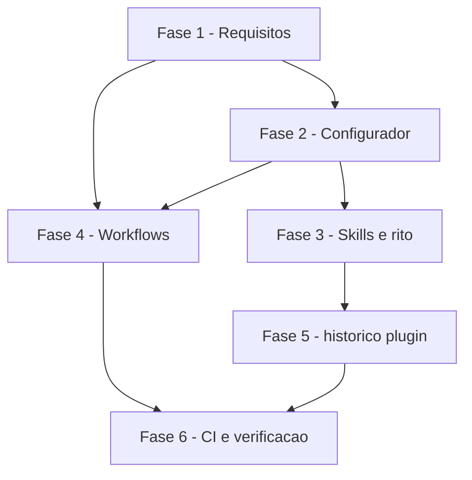

# Tarefas cockpit - modo-autonomo

Escopo: backlog da frente `modo-autonomo` (merge autonomo, trava de caminhos previstos, smoke/promocao em lote, barreira de agentes proibidos). Toda tarefa toca somente o bloco "Caminhos previstos" de `decisoes-do-owner.md` (normativo, nao editar) mais `docs/specs/modo-autonomo/**`. Sem dependencia nova (FR-027).

**Legenda de status:**
- `[ ]` Pendente
- `[~]` Em andamento
- `[x]` Concluido
- `[!]` Bloqueado

**Legenda de criticidade:**
- `[C]` Critico - Impacto financeiro direto ou bloqueante
- `[A]` Alto - Funcionalidade essencial
- `[M]` Medio - Necessario mas sem urgencia imediata

---

## FASE 1 - Fechamento de requisitos (gaps do checklist security)

### 1.1 Governanca A2/F1 na lista da spec `[C]`

Ref: checklists/security.md CHK012; spec.md FR-009; plan.md (lista de governanca)

- [x] 1.1.1 Ler o trecho do plan.md que traz A2/F1 e a lista de governanca vigente em FR-009
- [x] 1.1.2 Editar spec.md FR-009 listando explicitamente `.releaserc*`, `release.config.*`, chave `release` do `package.json` e todo `decisoes-do-owner.md` como caminhos de governanca
- [x] 1.1.3 Alinhar contracts/caminhos-previstos.md e data-model.md a mesma lista (sem divergencia entre artefatos)
- [x] 1.1.4 Marcar CHK012 em checklists/security.md citando esta tarefa

### 1.2 Escopo minimo do TOKEN_AUTOMACAO `[C]`

Ref: checklists/security.md CHK013; spec.md FR-005, FR-019; plan.md (token)

- [x] 1.2.1 Editar spec.md FR-019 definindo o escopo minimo do token (Contents e Pull requests: escrita; sem Administration nem Workflows; fora do repositorio) como requisito
- [x] 1.2.2 Garantir coerencia com FR-005 e contracts/modo-autonomo.md
- [x] 1.2.3 Marcar CHK013 em checklists/security.md

### 1.3 Fonte da conferencia de "sem bypass" `[C]`

Ref: checklists/security.md CHK020; spec.md FR-005, FR-012; research.md

- [x] 1.3.1 Localizar em research.md/plan.md o endpoint e o campo do GitHub que evidenciam ausencia de bypass no ruleset (fonte rastreavel; sem inventar nome de campo)
- [x] 1.3.2 Se a fonte nao estiver documentada, conferir a doc oficial via ctx_fetch_and_index (subagente folha) e citar a URL; sem fonte, abrir bloqueio humano
- [x] 1.3.3 Editar spec.md FR-005/FR-012 e contracts/modo-autonomo.md com a fonte da conferencia
- [x] 1.3.4 Marcar CHK020 em checklists/security.md

### 1.4 Clarify: "acrescimo puro em permissions.deny" `[A]`

Ref: checklists/security.md CHK014; spec.md US2 cenario 3, FR-009

- [x] 1.4.1 Propor definicao objetiva (ex.: diff do arquivo so adiciona entradas string ao array `permissions.deny`, sem remover, reordenar ou alterar outras chaves) e registrar como Decisao
- [x] 1.4.2 Registrar a definicao em spec.md (Clarifications) e FR-009, e em contracts/caminhos-previstos.md
- [x] 1.4.3 Prever caso de teste negativo (remocao/alteracao de regra reprova) para a Fase 4
- [x] 1.4.4 Marcar CHK014 em checklists/security.md

---

## FASE 2 - Configurador e constituicao semente (E1)

### 2.1 Chave MODO_AUTONOMO no configurar.sh `[A]`

Ref: spec.md FR-001, FR-004, FR-006; plan.md configurar.sh

- [x] 2.1.1 Aceitar `MODO_AUTONOMO` (ligado/desligado); ausente ou invalida vale desligado; `--atualizar` sem a chave nao falha
- [x] 2.1.2 Pergunta interativa com sugestao `desligado`
- [x] 2.1.3 Gravar a linha literal `Merge autônomo: ...` na constituicao semente
- [x] 2.1.4 Listar `MODO_AUTONOMO` entre as chaves que o rito nao consome e nao renderiza-la no template do rito
- [x] 2.1.5 Imprimir (apenas) a configuracao necessaria no GitHub: ruleset, auto-merge, identidade; nunca criar nada
- [x] 2.1.6 Cenarios de teste em scripts/testar-configurar.sh (ligado, desligado, ausente, invalido, atualizar)

### 2.2 cockpit.config.example e constituicao semente `[A]`

Ref: spec.md FR-002, FR-026; plan.md

- [x] 2.2.1 Documentar a chave opcional em cockpit.config.example
- [x] 2.2.2 Linha literal `Merge autônomo:` e Principio II com os dois ramos em templates/docs/constitution.md.semente.tmpl
- [x] 2.2.3 Regra de leitura unica (exatamente uma linha valida; senao desligado) na base
- [x] 2.2.4 Conferir que o cockpit nao ganha a linha (FR-026)

---

## FASE 3 - Skills e textos do rito (E2, E4)

### 3.1 Secao "Modo autonomo" no rito-dev `[A]`

Ref: spec.md FR-003, FR-005, FR-024; plan.md rito-dev

- [x] 3.1.1 Secao "Modo autonomo" em skills/rito-dev/SKILL.md com regra de leitura, conferencia de identidade/ruleset e ponteiros nas Fases 6 a 10
- [x] 3.1.2 Mesma secao em templates/docs/rito-dev.md.tmpl, ramo desligado identico ao atual
- [x] 3.1.3 Correcoes e smoke: limites de 2 correcoes, revert, estacionada (FR-014 a FR-016)
- [x] 3.1.4 Smoke `Sn | comando | esperado literal | tipo` e promocao em lote (FR-017 a FR-020)
- [x] 3.1.5 Teste/verificacao textual: ramo desligado inalterado (diff conferido)

### 3.2 Ponteiros ao Principio II nos demais textos `[M]`

Ref: spec.md FR-024

- [x] 3.2.1 templates/CLAUDE.md.semente.tmpl aponta ao Principio II
- [x] 3.2.2 Papeis implementador e revisor (templates/docs/agentes/*.tmpl)
- [x] 3.2.3 templates/docs/project-context.md.semente.tmpl e templates/.cockpit/LEIAME.md.tmpl
- [x] 3.2.4 Conferir que nenhum repete a regra (so aponta)

### 3.3 rito-descoberta: registro da Fase 0 e correcoes `[A]`

Ref: spec.md FR-007, FR-021 a FR-023; plan.md rito-descoberta/SKILL.md

- [x] 3.3.1 PR propria de registro da Fase 0 aprovada pelo owner no modo ligado; fluxo desligado intacto
- [x] 3.3.2 Mesclar regras deny (uniao, idempotente) + negacao de Edit/Write nas configuracoes do agente
- [x] 3.3.3 Rodar de novo no gate da Fase 11 e em SHA divergente; regra que nao bloqueia para o rito
- [x] 3.3.4 Corrigir a lista fechada "conteudo so de agentes" conforme FR-022
- [x] 3.3.5 Verificacao textual da skill contra contracts/historico-plugin.md

---

## FASE 4 - Workflows e CODEOWNERS (E5)

### 4.1 Workflow caminhos-previstos `[C]`

Ref: spec.md FR-008 a FR-011; contracts/caminhos-previstos.md

- [x] 4.1.1 Criar templates/.github/workflows/caminhos-previstos.yml.tmpl rodando da branch padrao, sem executar codigo do PR, status no SHA do HEAD, fonte fixada
- [x] 4.1.2 Parse do bloco "Caminhos previstos" da base (so caminho literal ou `dir/**`), `docs/specs/<frente>/**` implicito
- [x] 4.1.3 Reprovar fora do bloco, renomeacao com nome novo/anterior fora, total diferente de `changed_files`, governanca (salvo acrescimo puro em deny, conforme 1.4), manifesto/lockfile sem item permanente aprovado
- [x] 4.1.4 PR de correcao/revert: so arquivos da PR original, referenciada por numero, mesma base; frente identificada pelo registro
- [x] 4.1.5 Rodar tambem em PR para a producao: passa sozinha so a promocao; demais exigem aprovacao de dono no commit atual (A1)
- [x] 4.1.6 Testes do workflow no CI (casos positivos e negativos, incluindo CHK014)

### 4.2 Ajustes nos workflows existentes e CODEOWNERS `[C]`

Ref: spec.md FR-010, FR-012, FR-013, FR-019; plan.md

- [x] 4.2.1 require-codeowner-approval: ler a linha na base, passar com aviso no modo ligado; aprovacao no commit atual com reexecucao
- [x] 4.2.2 audit-merge-vermelho: nao abrir issue a cada merge autonomo
- [x] 4.2.3 promotion-pr: token de automacao, auto-merge com merge commit conferido, SHA pre-promocao anotado
- [x] 4.2.4 CODEOWNERS.tmpl cobrindo governanca (lista de 1.1)
- [x] 4.2.5 Testes/verificacao dos templates renderizados

---

## FASE 5 - Subcomando historico.mjs plugin e barreira deny (E6)

### 5.1 `historico.mjs plugin <installPath>` `[A]`

Ref: spec.md FR-021, FR-022; contracts/historico-plugin.md

- [x] 5.1.1 Implementar subcomando de leitura com saida JSON (veredito, regras deny dos agentes que reprovam em (a)(b)(c), SHA)
- [x] 5.1.2 Falhar fechado com symlink e installPath fora do cache de plugins
- [x] 5.1.3 Regras de `.in_use/` (so `^[0-9]+$` regulares), `.orphaned_at`, `.md` na raiz com frontmatter valido e nome sem colisao
- [x] 5.1.4 Testes em skills/rito-descoberta/historico.test.mjs (aprova, reprova, symlink, fora do cache, ENOENT)

---

## FASE 6 - CI, documentacao e verificacao final

### 6.1 CI e documentacao `[A]`

Ref: spec.md FR-025; plan.md ci.yml, README

- [x] 6.1.1 .github/workflows/ci.yml executa testar-configurar.sh e historico.test.mjs
- [x] 6.1.2 README.md documenta a chave e o comportamento
- [x] 6.1.3 docs/specs/configurar/contracts/cli.md atualizado com `MODO_AUTONOMO`
- [x] 6.1.4 Rodar o CI local e registrar o resultado — `scripts/testar-configurar.sh`: OK, todos os cenários passaram; `historico.test.mjs`: todos ok. shellcheck e actionlint ausentes nesta máquina: só no CI (não executados).

### 6.2 Verificacao contra quickstart e Caminhos previstos `[A]`

Ref: quickstart.md; spec.md FR-027, SC

- [x] 6.2.1 Executar os cenarios do quickstart.md
- [x] 6.2.2 Conferir `git diff --name-only` contra o bloco "Caminhos previstos" (nenhum fora)
- [x] 6.2.3 Conferir ausencia de dependencia nova (manifestos/lockfiles intactos)
- [x] 6.2.4 Conferir que nenhum processo em background ficou da execucao

---

## Matriz de Dependencias

## Resumo Quantitativo

| Fase | Tarefas | Subtarefas | Criticidade |
|------|---------|------------|-------------|
| 1 - Requisitos | 4 | 15 | C |
| 2 - Configurador | 2 | 10 | A |
| 3 - Skills e rito | 3 | 14 | A |
| 4 - Workflows | 2 | 11 | C |
| 5 - historico plugin | 1 | 4 | A |
| 6 - CI e verificacao | 2 | 8 | A |
| **Total** | **14** | **62** | - |

## Escopo Coberto

| Item | Descricao | Fase |
|------|-----------|------|
| E1 | Chave, constituicao semente, config example | 2 |
| E2 | Secao Modo autonomo e textos alinhados | 3 |
| E3 | Identidade e ruleset conferidos | 1, 3 |
| E4 | Registro da Fase 0 | 3 |
| E5 | Workflows e CODEOWNERS | 4 |
| E6 | historico plugin e barreira deny | 3, 5 |
| E7 | README e contrato do configurar | 6 |
| CHK012/013/014/020 | Gaps do checklist security | 1 |

## Escopo Excluido

| Item | Descricao | Motivo |
|------|-----------|--------|
| CHK015/026/033/034 | Itens humanos do checklist | Resolvidos pelo owner (dec-029) |
| Edicao de decisoes-do-owner.md | Registro normativo | So o owner emenda |
| Merge autonomo no cockpit | Linha `Merge autônomo:` no cockpit | FR-026: cockpit mantem gate humano |
| Tier de entrega | Nao citado nos args | Backlog completo gerado |

## FASE 7 - Convergência

> Fase gerada automaticamente pela skill `converge` (reconciliação
> spec-vs-código). Cada tarefa abaixo corresponde a um achado (`Gap`)
> entre o que `spec.md`/`plan.md`/`tasks.md` descreveram e o estado
> presente do código. Tarefas sem o prefixo `[Revisar]` são acionáveis
> (`missing`/`partial`/`contradicts`); tarefas com `[Revisar]` são item de
> revisão (`unrequested`, FR-013) — nunca "implementar", o código já
> existe. Append-only: esta fase nunca reescreve fases/tarefas anteriores
> do arquivo (FR-009).

### 7.1 configurar.sh não imprime a fonte esperada do status da trava `[C]`

Ref: FR-008; plan.md §`configurar.sh` (R2: "O configurador imprime a instrução de escolher como fonte esperada o app que publica esse status") · tipo: `partial` · severidade: `HIGH`

`imprimir_config_github` em `configurar.sh` lista os rulesets com os checks obrigatórios (`ci`, `commitlint`, `caminhos-previstos` e, quando integração ≠ produção, `caminhos-previstos-producao`), mas não manda fixar a fonte esperada do status (o app que publica o status, `integration_id` da regra `required_status_checks`). O plan pede "fonte esperada do status" no ruleset da integração e "a mesma fonte esperada" no da produção; sem isso, o FR-008 ("status ... com fonte fixada") e a borda "job homônimo forjando o status" dependem de o owner adivinhar a configuração. Completar é aditivo (linhas de impressão), sem escrever ID numérico (R2: o ID do app não tem fonte).

- [x] 7.1.1 Implementar/corrigir `configurar.sh` conforme `FR-008`: nas linhas dos rulesets da integração e da produção, imprimir que a fonte esperada dos checks `caminhos-previstos`/`caminhos-previstos-producao` é o app que publica o status da trava (o do `GITHUB_TOKEN` do workflow, R2; que seja o GitHub Actions continua NÃO VERIFICADO e o S3 prova), sem ID numérico
- [x] 7.1.2 Cobrir a impressão no cenário 26 de `scripts/testar-configurar.sh` (ligado com integração = produção e com integração ≠ produção)

<!-- converge-key: 1b622ec87e37 -->

### 7.2 Falta a camada extra `permissions.deny` contra o `--admin` `[C]`

Ref: FR-012; decisoes-do-owner.md D5 ("Nunca `--admin`; `permissions.deny` para ele como camada extra"); contracts/modo-autonomo.md §3; research.md §Pendências ("Sintaxe da regra deny de Bash para `--admin` | implementação (fonte)") · tipo: `partial` · severidade: `HIGH`

`skills/rito-dev/SKILL.md` (e o espelho `templates/docs/rito-dev.md.tmpl`), item 3 da seção "Modo autônomo", só diz "Nunca `--admin`"; nenhum texto do rito grava a regra `permissions.deny` que o FR-012 e o D5 exigem como camada extra, e a barreira da `skills/rito-descoberta/SKILL.md` ("Barreira técnica (D9)", passo 2) mescla só o `deny` dos agentes e `Edit(/.claude/settings*.json)`. A pendência da research previa fechar a sintaxe da regra de Bash na implementação, com fonte oficial; não há Decisão registrada fechando-a. Completar é aditivo.

- [x] 7.2.1 Conferir na doc oficial de permissões do Claude Code (via `ctx_fetch_and_index`, subagente folha; Princípio V) a sintaxe de regra `Bash(...)` em `permissions.deny` que casa `gh pr merge` com `--admin` em qualquer posição; sem fonte, registrar bloqueio humano em vez de inventar a forma
- [x] 7.2.2 Implementar/corrigir `skills/rito-dev/SKILL.md` e `templates/docs/rito-dev.md.tmpl` conforme `FR-012`: no item 3 do "Modo autônomo", gravar essa regra no `.claude/settings.json` da worktree (união idempotente, como na barreira D9) antes de ligar o auto-merge, e citá-la como camada extra; ramo desligado intacto
- [x] 7.2.3 Se a regra entrar pela barreira da `skills/rito-descoberta/SKILL.md` (passo 2), incluir a mesma regra na conferência dos passos 3 e da Fase 11; prova de bloqueio fica no smoke S3/S4 (regra que não bloqueia para o rito)

<!-- converge-key: 2b22f5e784ff -->

### 7.3 Fase 0 não pede o smoke no formato `Sn | comando | esperado literal | tipo` `[A]`

Ref: FR-017; decisoes-do-owner.md D7 ("congelado no Gate 0 (mudar exige OK do owner)") · tipo: `partial` · severidade: `MEDIUM`

O FR-017 exige cada item de smoke no formato `Sn | comando | esperado literal | tipo`, com asserção além do exit code e ao menos um caso negativo, congelado no Gate 0. O consumo está na `rito-dev` ("Modo autônomo", item 6), mas a `skills/rito-descoberta/SKILL.md`, que conduz o Gate 0 e grava o registro, só manda "colete ... smoke" (seção "Itens do registro") e não pede esse formato nem o congelamento. No modo ligado, o registro sai com smoke em prosa e a frente cai sempre no gate humano do merge (item 6), o que impede o SC-003. Completar é aditivo.

- [x] 7.3.1 Implementar/corrigir `skills/rito-descoberta/SKILL.md` conforme `FR-017`: em "Itens do registro", no modo ligado (lido pela regra da `rito-dev`, citada), a seção `Smoke` traz itens `Sn | comando | esperado literal | tipo` (`positivo`, `negativo` ou `manual`), com ao menos um `negativo`, congelados no Gate 0 (mudar exige OK do owner); apontar para o item 6 do "Modo autônomo" da `rito-dev` em vez de repetir a regra de execução; fluxo desligado intacto

<!-- converge-key: 2fa81af73dde -->

## FASE 8 - Convergência

> Fase gerada automaticamente pela skill `converge` (reconciliação
> spec-vs-código). Cada tarefa abaixo corresponde a um achado (`Gap`)
> entre o que `spec.md`/`plan.md`/`tasks.md` descreveram e o estado
> presente do código. Tarefas sem o prefixo `[Revisar]` são acionáveis
> (`missing`/`partial`/`contradicts`); tarefas com `[Revisar]` são item de
> revisão (`unrequested`, FR-013) — nunca "implementar", o código já
> existe. Append-only: esta fase nunca reescreve fases/tarefas anteriores
> do arquivo (FR-009).

### 8.1 A prova de bloqueio da regra `--admin` não tem passo nem consequência `[C]`

Ref: FR-012; task 7.2.3 ("prova de bloqueio fica no smoke S3/S4 (regra que não bloqueia para o rito)"); Princípio V ("o que não foi medido diz 'não medido'") · tipo: `partial` · severidade: `HIGH`

A FASE 7 gravou as regras `Bash(gh pr merge *--admin*)` e `Bash(gh * pr merge *--admin*)` (rito-dev item 3, espelho no template e barreira da `skills/rito-descoberta/SKILL.md` passos 2, 3 e Fase 11), com a sintaxe do `*` citada da doc oficial (dec-047). O texto não afirma como fato que a regra bloqueia o `--admin` e delega a prova ao "smoke S3/S4". Falta o que torna essa delegação verdadeira: em `skills/rito-descoberta/SKILL.md`, passo 4 ("Regra que não bloqueia para o rito"), a consequência cobre só o S4 (agente do `deny` e edição das configurações), não as regras `--admin`; e o caso `--admin com a credencial do agente` do S3 (quickstart Scenario 9, passo 4) espera só "para, sem merge", resultado que a identidade do D2 já produz sozinha, sem distinguir recusa pela ferramenta (`deny`) de recusa pelo GitHub. S4 não exercita regra de Bash. Hoje uma regra `--admin` que não casa passaria despercebida. Completar é aditivo.

- [x] 8.1.1 Implementar/corrigir `skills/rito-descoberta/SKILL.md` conforme `FR-012`: no passo 4 da "Barreira técnica (D9)", incluir as regras `--admin` (modo `ligado`): o smoke S3 prova que a ferramenta recusa o comando antes de ele chegar ao GitHub; sem essa prova, o rito para e volta ao owner, como já vale para o S4
- [x] 8.1.2 Em `docs/specs/modo-autonomo/quickstart.md`, Scenario 9 passo 4, separar o caso `--admin`: esperado "recusado pela ferramenta (`deny`), sem chamada ao GitHub" nas formas `gh pr merge <n> --admin` e `gh -R <repo> pr merge <n> --admin`, além do "sem merge" pela identidade
- [x] 8.1.3 Em `skills/rito-dev/SKILL.md` e `templates/docs/rito-dev.md.tmpl` (item 3 do "Modo autônomo"), apontar o caso exato do S3 em vez de "S3/S4" e dizer que, até esse registro, o bloqueio é não medido; manter a sintaxe citada e o ramo desligado intactos
- [x] 8.1.4 Alinhar `docs/specs/modo-autonomo/contracts/modo-autonomo.md` §3 ("sintaxe da regra de Bash a confirmar") e a linha da pendência em `research.md` à sintaxe já conferida (dec-047, <https://code.claude.com/docs/en/permissions>)

<!-- converge-key: b9813ea46144 -->
