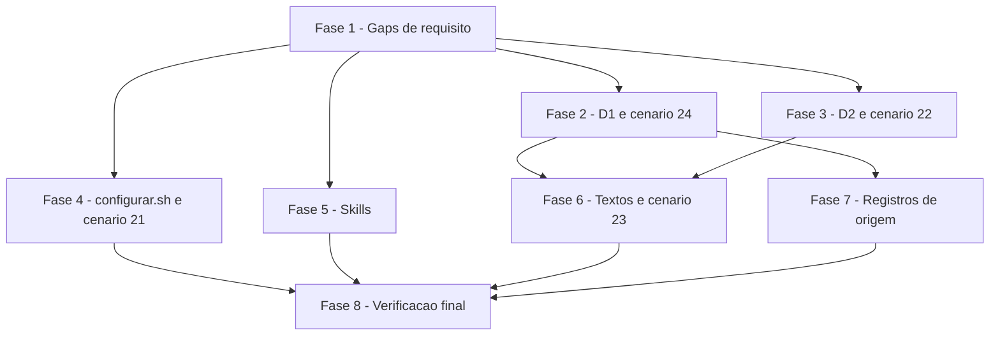

# Tarefas ciclo_dev - Correções do code review retroativo do lote 21-25

Escopo: corrigir os achados D1 a D7 de `decisoes-do-owner.md` em arquivos já existentes (fluxos modelo, `configurar.sh`, `scripts/testar-configurar.sh`, duas skills e registros das frentes de origem), sem arquivo, função, permissão ou dependência novos. As decisões do owner são normativas e não são reabertas.

**Legenda de status:**
- `[ ]` Pendente
- `[~]` Em andamento
- `[x]` Concluido
- `[!]` Bloqueado

**Legenda de criticidade:**
- `[C]` Critico - Impacto financeiro direto ou bloqueante
- `[A]` Alto - Funcionalidade essencial
- `[M]` Medio - Necessario mas sem urgencia imediata

---

## FASE 1 - Fechar os gaps de requisito do checklist

### 1.1 Fechar CHK005, CHK020 e CHK021 na spec e na research `[A]`

Ref: checklists/requirements.md CHK005, CHK020, CHK021; spec.md FR-002, FR-003, FR-006

- [x] 1.1.1 CHK005: fixar em `contracts/passos.md` o texto exato da linha nova do `--atualizar` (nomeia a chave, não repete o valor, diz que, se é o nome real da branch, a saída é renomear a branch no remoto para um nome dentro do conjunto e atualizar a chave), em pt-BR com acentuação
- [x] 1.1.2 CHK020: acrescentar a FR-003 e a Edge Cases que só o par de aspas simples envolvente é removido; aspas duplas ou desbalanceadas permanecem no valor, não casam com a regra da chave e PARAM a skill nomeando a chave
- [x] 1.1.3 CHK021: acrescentar a FR-002 e a `data-model.md` que review `COMMENTED` (e `PENDING`) é ignorada pelo `--jq` e não altera o último estado do usuário (a aprovação anterior no head continua valendo)
- [x] 1.1.4 Marcar CHK005, CHK020 e CHK021 como `[x]` em `checklists/requirements.md`, citando onde foram fechados

### 1.2 Registrar CHK026 como ponto de atenção do owner `[M]`

Ref: checklists/requirements.md CHK026; decisoes-do-owner.md D4, D5

- [x] 1.2.1 Anotar no `plan.md` (Riscos) que PARAR (falhar fechado) para valor fora da regra é a decisão D4/D5 do owner, vigente e não reaberta
- [x] 1.2.2 Deixar CHK026 aberto como `{humano}` com a nota "confirmado nas decisões D4/D5; revisão do owner na PR"
- [x] 1.2.3 Levar CHK026 ao corpo da PR como ponto para o owner conferir (a ser incluído no corpo da PR no finalize)

---

## FASE 2 - D1: auditoria nunca filtra por regra ilegível (cenário 24)

### 2.1 Corrigir a leitura das regras em `audit-merge-vermelho` `[C]`

Ref: spec.md FR-001, FR-011; research.md Decision 1 e 9; decisoes-do-owner.md D1

- [x] 2.1.1 Em `templates/.github/workflows/audit-merge-vermelho.yml.tmpl`, trocar `|| true` por `|| : >"$obrigatorios"` na chamada das regras, mantendo `2>/dev/null`
- [x] 2.1.2 Adicionar `export LC_ALL=C` ao passo `run:` alterado
- [x] 2.1.3 Reescrever o comentário `ponytail:` conforme research Decision 3 de origem (teto da varredura; `since` ou `creator` exige nova decisão do owner) e Decision 6 desta frente
- [x] 2.1.4 Conferir que o ramo sem regra legível lista todos os vermelhos com a nota de regra ilegível

### 2.2 Estender o cenário 24 de `scripts/testar-configurar.sh` `[C]`

Ref: spec.md FR-010, SC-002; research.md Decision 7

- [x] 2.2.1 Colocar o bloco do 24 sob a mesma guarda de `jq` do 22 (pula fora do CI, falha com `COCKPIT_EXIGIR_FERRAMENTAS=1`)
- [x] 2.2.2 Fazer o `gh` falso guardar `$*` e sair com código próprio na rota de issues se faltar `--paginate` ou `state=all`
- [x] 2.2.3 Caso novo: rota de regras imprime corpo JSON de erro no stdout e sai com 1; conferir que a issue lista `ci` e `lint` com a nota de regra ilegível
- [x] 2.2.4 Rodar o caso novo contra o `|| true` antigo e confirmar que falha (SC-002), depois com a correção e confirmar que passa
- [x] 2.2.5 Adicionar `export LC_ALL=C` ao script de testes (uma vez, após `set -euo pipefail`)

---

## FASE 3 - D2: último estado por usuário, depois o head (cenário 22)

### 3.1 Corrigir o `awk` de `require-codeowner-approval` `[C]`

Ref: spec.md FR-002; research.md Decision 2; decisoes-do-owner.md D2

- [x] 3.1.1 Em `templates/.github/workflows/require-codeowner-approval.yml.tmpl`, fazer o `awk` guardar por login (minúsculas) o estado e o `commit_id` da última linha, sem filtrar `$3 == head` antes
- [x] 3.1.2 Imprimir o login no fim só se o estado é `approved` e o `commit_id` guardado é igual ao head
- [x] 3.1.3 Manter a guarda de head vazio e a falha fechada quando o `gh` não lê o head; adicionar `export LC_ALL=C`
- [x] 3.1.4 Conferir que `COMMENTED`/`PENDING` continuam ignoradas pelo `--jq` (CHK021)

### 3.2 Estender o cenário 22 `[C]`

Ref: spec.md FR-010, US2; research.md Decision 7

- [x] 3.2.1 Caso: pedido de mudança posterior preso a commit antigo anula a aprovação no head
- [x] 3.2.2 Caso: dono aprova commit antigo e não dono (segundo login fora do `CODEOWNERS` falso) aprova o head
- [x] 3.2.3 Casos: reaprovação no head conta; `DISMISSED` não conta; `commit_id` nulo não conta
- [x] 3.2.4 Casos: falha do `gh` ao ler o head falha fechado; `COMMENTED` posterior à aprovação não a anula (CHK021)
- [x] 3.2.5 Confirmar que os casos de pedido de mudança antigo falham com o filtro `$3 == head` antigo (SC-002)

---

## FASE 4 - D6 em `configurar.sh` e cenário 21

### 4.1 Dica de renomear a branch no `--atualizar` `[A]`

Ref: spec.md FR-006; research.md Decision 5; contracts/passos.md; checklist CHK005

- [x] 4.1.1 Em `validar_chave` (`configurar.sh`), no ramo `BRANCH_INTEGRACAO | BRANCH_PRODUCAO`, emitir a linha nova só quando `MODO` é `atualizar`, com o texto fixado em 1.1.1
- [x] 4.1.2 Manter exit 1, a linha "Corrija o valor no cockpit.config" e nenhum arquivo alterado; não repetir o valor recusado
- [x] 4.1.3 Conferir que `--respostas` e o modo interativo não ganham a linha nova
- [x] 4.1.4 Conferir que `configurar.sh` segue sem findings de shellcheck (CI) e com `LC_ALL=C` já exportado

### 4.2 Estender o cenário 21 `[A]`

Ref: spec.md FR-010, US6; research.md Decision 7 e 8; decisoes-do-owner.md D7

- [x] 4.2.1 Montar lista única de valores recusados usada nos casos 1 e 3b: os de hoje mais `a..b`, `x.lock`, `a/`, `-x`, `.x`, `/x` e `á`
- [x] 4.2.2 Caso 1: conferir que o repositório continua sem arquivo fora de `.git` e que o `cstk` falso não recebeu `hooks install`
- [x] 4.2.3 Caso 3b: conferir a mensagem completa (chave, conjunto, linha de correção e dica de renomear)
- [x] 4.2.4 Caso 4: conferir a mensagem de erro no tty
- [x] 4.2.5 Caso novo: manifesto anterior que ficaria vazio continua existindo e é regravado sem linhas (exit 0), sem mudar `gravar_manifesto`
- [x] 4.2.6 Alinhar a redação de US6 cenário 2 na spec à regra do manifesto (research Decision 8), se ainda divergir

---

## FASE 5 - D3, D4 e D5: skills

### 5.1 `rito-dev`: aspas antes da conferência e `REPO_REMOTO` `[A]`

Ref: spec.md FR-003, FR-004; research.md Decision 3; decisoes-do-owner.md D3, D4; checklist CHK020

- [x] 5.1.1 Em `skills/rito-dev/SKILL.md`, reescrever o parágrafo de leitura na ordem: tirar o par de aspas simples envolvente, conferir `BRANCH_*`, conferir `REPO_REMOTO` com a regra `RE_REPO` (sem `.` nem `..` como parte)
- [x] 5.1.2 Dizer que aspas duplas ou desbalanceadas permanecem e param a skill (CHK020), e que fora da regra a skill PARA nomeando a chave sem colar o valor num comando
- [x] 5.1.3 Remover a frase das aspas da lista de regras para não haver duas instruções em ordens diferentes
- [x] 5.1.4 Ler a skill com `cockpit.config` de exemplo (aspas simples válidas, inválido, duplas) e conferir o resultado esperado de cada um

### 5.2 `parallel-work`: conferir branches antes do `--base` `[A]`

Ref: spec.md FR-005; research.md Decision 4; decisoes-do-owner.md D5

- [x] 5.2.1 Em `skills/parallel-work/SKILL.md`, acrescentar ao parágrafo da base explícita: tirar o par de aspas simples e conferir `BRANCH_INTEGRACAO` e `BRANCH_PRODUCAO` com `^[A-Za-z0-9][A-Za-z0-9._/-]*$` antes de compor o `--base`
- [x] 5.2.2 Dizer que fora da regra a skill PARA nomeando a chave, sem colar o valor num comando
- [x] 5.2.3 Ler a skill com valores válidos entre aspas e inválidos e conferir a ordem aspas, conferência, `--base`

---

## FASE 6 - D6: textos dos modelos e cenário 23

### 6.1 Texto da opção nativa nos modelos `[M]`

Ref: spec.md FR-007; research.md Decision 6 e F2

- [x] 6.1.1 Em `require-codeowner-approval.yml.tmpl` (cabeçalho), dizer que a opção nativa descarta a aprovação só quando entra commit que altera o diff do PR e que o check do fluxo é mais estrito, mantendo os nomes literais das opções
- [x] 6.1.2 Fazer o mesmo em `templates/.github/CODEOWNERS.tmpl`
- [x] 6.1.3 Conferir pt-BR com acentuação e que o cenário 22, caso 5, segue verde

### 6.2 Cenário 23, caso 6 `[M]`

Ref: spec.md FR-010; decisoes-do-owner.md D7

- [x] 6.2.1 Estender o caso 6 para conferir, só nas linhas de comentário antes de `name:`, as duas afirmações de D2 de `promotion-pr-arvores` (merge commit como na Fase 9 do `rito-dev`; com squash o fluxo não abre nem reabre PR quando o conteúdo já é igual)
- [x] 6.2.2 Confirmar que o caso falha se o cabeçalho perder as afirmações

---

## FASE 7 - D6: registros das frentes de origem

### 7.1 Corrigir research e contrato de `audit-merge-vermelho` `[M]`

Ref: spec.md FR-008, FR-009; research.md Decision 6; decisoes-do-owner.md D1, D6

- [x] 7.1.1 Em `docs/specs/audit-merge-vermelho/contracts/github-rest.md`, citar o filtro `has("pull_request") | not` e descrever o mecanismo de Decision 1 no "Erro" das regras
- [x] 7.1.2 Em `docs/specs/audit-merge-vermelho/research.md`, Decision 1: trocar a afirmação sem fonte por M1 e M3, corrigindo que a falha "cai no aviso de regra ilegível"
- [x] 7.1.3 Manter "não medido" para o casamento do nome cru com as regras de branch com `/`

### 7.2 Registrar fatos medidos em `promotion-pr-arvores` `[M]`

Ref: spec.md FR-009; research.md Decision 6; decisoes-do-owner.md "Fatos medidos"

- [x] 7.2.1 Em `docs/specs/promotion-pr-arvores/research.md`, Decision 4: registrar M1 para 404 em `rules/branches` e F4 ("exit code will be 1") para `commits/heads/…` e 5xx, com a ressalva da página
- [x] 7.2.2 No "Limite conhecido", registrar M2 para branch com `/`
- [x] 7.2.3 Conferir que nenhuma afirmação de API ficou sem fonte ou medição

---

## FASE 8 - Verificação final

### 8.1 Gates de qualidade da frente `[A]`

Ref: spec.md FR-011, SC-001 a SC-004

- [x] 8.1.1 Rodar `LC_ALL=C bash scripts/testar-configurar.sh` e ver cenários 21 a 24 verdes
- [x] 8.1.2 Rodar shellcheck e actionlint (ou confirmar no CI) com zero findings nos scripts e fluxos alterados (shellcheck e actionlint ausentes nesta máquina: verificação delegada ao CI da PR)
- [x] 8.1.3 Rodar `verificar-agnostico.sh` e conferir que nada nomeia projeto real
- [x] 8.1.4 Revisar o diff completo contra FR-001 a FR-011 e contra "Fora de escopo" das decisões do owner

---

## Matriz de Dependencias

## Resumo Quantitativo

| Fase | Tarefas | Subtarefas | Criticidade |
|------|---------|------------|-------------|
| 1 - Gaps de requisito | 2 | 7 | A |
| 2 - D1 e cenario 24 | 2 | 9 | C |
| 3 - D2 e cenario 22 | 2 | 9 | C |
| 4 - configurar.sh e cenario 21 | 2 | 10 | A |
| 5 - Skills | 2 | 7 | A |
| 6 - Textos e cenario 23 | 2 | 5 | M |
| 7 - Registros de origem | 2 | 6 | M |
| 8 - Verificacao final | 1 | 4 | A |
| **Total** | **15** | **57** | - |

## Escopo Coberto

| Item | Descricao | Fase |
|------|-----------|------|
| CHK005, CHK020, CHK021, CHK026 | Gaps e ponto humano do checklist | 1 |
| D1 / FR-001 | Falha na leitura das regras nunca filtra | 2 |
| D2 / FR-002 | Último estado por usuário e head atual | 3 |
| D6 / FR-006 | Dica de renomear a branch no `--atualizar` | 4 |
| D7 / FR-010 | Casos novos nos cenários 21 a 24 | 2, 3, 4, 6 |
| D3, D4 / FR-003, FR-004 | `rito-dev`: aspas e `REPO_REMOTO` | 5 |
| D5 / FR-005 | `parallel-work`: branches antes do `--base` | 5 |
| D6 / FR-007, FR-008 | Textos dos modelos, `ponytail:` e contrato | 2, 6, 7 |
| D1, D6 / FR-009 | Research das frentes de origem | 7 |
| FR-011 | `LC_ALL=C`, shellcheck, actionlint, pt-BR, agnosticismo | 2, 3, 8 |

Tier de entrega usado na geração deste backlog: não informado nos args; backlog completo.

## Escopo Excluido

| Item | Descricao | Motivo |
|------|-----------|--------|
| Fora de escopo de D1-D7 | Limite do rodapé do commitlint, custo da varredura de issues, PR de promoção aberta com árvores iguais, pré-existentes do `promotion-pr`, endpoint de commits pesado, head lido da API, regras de nome do git nas skills, disputa da `parallel-work` instalada | Adiados por decisão do owner em `decisoes-do-owner.md` |
| Cópia instalada de skills | `~/.claude/skills/` | Fora do repositório |
| Branch com `/` em `rules/branches` | Casamento do nome cru com regras | Não medido; codificação de hoje fica |
